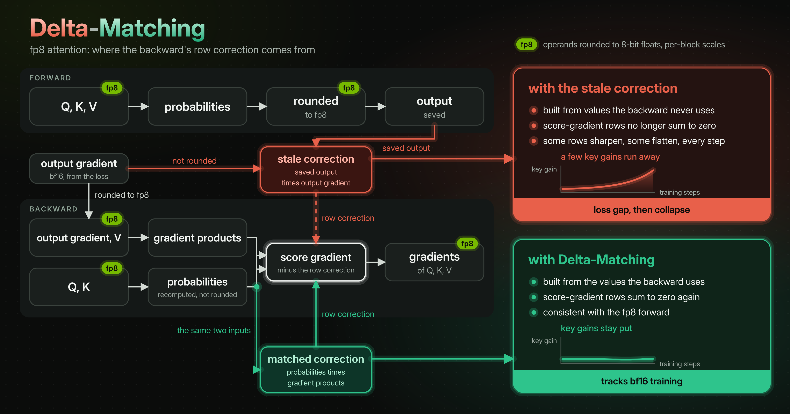

# delta-matching

<div align="center">
  <a href="https://arxiv.org/abs/2609.37852"></a> &ensp;
  <a href="https://huggingface.co/collections/cx-cmu/delta-matching"></a> &ensp;
  <a href="https://jet-ai-projects.github.io/delta-matching/"></a> &ensp;
  <a href="https://github.com/cxcscmu/delta-matching-train"></a>
</div>

This repository contains the official kernel implementation of Delta-Matching, along with an implementation of naive FP8 attention.



fp8 attention for training on Hopper with the **Delta-Matching** backward: the attention core runs in fp8 in both
directions, and the backward's softmax-gradient centering term (delta) is built from the kernel's own fp8 P / dP
pair instead of the conventional `rowsum(dO * O)`. That keeps the row-sum identity `rowsum(dS) = 0` at fp32 round-off
inside the fp8 arithmetic, which is what lets an all-fp8 attention backward train without the slow divergence a stale
delta causes. The same binary also runs the conventional ("stale") delta, so the two can be compared on the same code.


It is a drop-in for flash-attention call sites: same tensor layout, same signature, one import to change.

```python
from delta_matching import dm_attn_func            # or: from delta_matching import flash_attn_func

o = dm_attn_func(q, k, v, causal=True, mode="matched")   # q (B, N, H, D), k / v (B, N, Hk, D) bf16 -> o (B, N, H, D)
o = dm_attn_func(q, k, v, causal=True, mode="stale")     # the conventional delta, for comparison
```

## What it supports

| | |
|---|---|
| hardware | NVIDIA Hopper (sm90), CUDA 13, PyTorch >= 2.12, Triton (the quantization producers) |
| head dims | 128 and 256 (one binary serves both) |
| layout | flash-attention: `(batch, seqlen, nheads, headdim)`, bf16 in, bf16 out; GQA / MQA (`nheads % nheads_k == 0`) |
| attention | self-attention (q, k, v share `seqlen`); causal (both modes) or full (stale mode only); `seqlen % 256 == 0` at head dim 128, `seqlen % 128 == 0` at head dim 256; `batch * nheads <= 65535`; `softmax_scale` fixed at `headdim ** -0.5`; no dropout, sliding windows, softcap, alibi, variable-length batches or KV cache |
| numerics | Q, K, V, dO as e4m3 codes with per-block fp32 scales (K centered by its per-head mean); a faithful per-row, per-32-key P basis in the forward; the backward's five matmuls in fp8; deterministic O, dQ, dK, dV |
| modes | `"matched"`: delta from the backward's own fp8 P / dP (pass 0 of the kernel), `rowsum(dS) = 0` to fp32 round-off. `"stale"`: delta = `rowsum(dO * O)` |

Inputs outside this contract raise `ValueError`, `TypeError` or `NotImplementedError` naming the constraint; the compiled
ops check their own inputs too (`RuntimeError`). `dm_attn_func_bhnd` takes `(batch, nheads, seqlen, headdim)` and returns
the kernel's native `(batch, seqlen, nheads, headdim)` output. `flash_attn_func` has flash-attention 2's signature
(`dropout_p, softmax_scale, causal, window_size, softcap, alibi_slopes, deterministic, return_attn_probs`, then `mode`)
and raises `NotImplementedError` for the arguments this kernel does not implement; `deterministic` is accepted and
ignored, since every output is deterministic.

## Accuracy

Every operand (Q, K, V, P, dO, dS) is rounded to e4m3, so the error against fp32 attention is the fp8 rounding floor: on
Gaussian inputs about 0.04 relative for O and dV and 0.06 for dQ and dK (`tests/test_dm_attn.py` bounds them at twice
that). Like any fp8 attention, the forward loses accuracy as the logit range grows: with q and k scaled by 3, 10 and 30,
the relative error of O is 0.12, 0.28 and 0.33, the same as FlashAttention-3's own fp8 forward (0.12, 0.28, 0.33);
models with qk-norm stay in the first regime.

## Install

```bash
git clone https://github.com/jet-ai-projects/delta-matching
cd delta-matching
git submodule update --init third_party/flash-attention                  # flash-attention, pinned
git -C third_party/flash-attention submodule update --init csrc/cutlass   # its CUTLASS (a recursive init also pulls ~1.3 GB of ROCm submodules)
pip install "setuptools>=77" wheel ninja           # the build tools (the install below does not isolate the build)
MAX_JOBS=8 pip install --no-build-isolation .     # builds against the installed torch, which must be a CUDA 13 (cu130) build
```

The kernels compile against the `hopper/` headers of flash-attention at commit `0251105a2fb19d2957484b7f023cd8c115286ced`
and its CUTLASS submodule (`7127592069c2fe01b041e174ba4345ef9b279671`); `DM_FA_SRC` points at an existing checkout
instead. `nvcc` 13 must be found (set `CUDA_HOME` to the CUDA 13 toolkit, e.g. `/usr/local/cuda-13.0`, if it is not);
the build takes about 1.5 minutes with `MAX_JOBS=8` on a large node. Tested with PyTorch 2.12.0+cu130 and Triton 3.7.0.
`python -m delta_matching.jit`, run inside the checkout, is the alternative to pip: it builds into `delta_matching/_jit`
and links `delta_matching/_C.so` (the loader refuses a package directory that holds both a pip-built and a JIT-built
library); the package is then imported from the checkout, so run Python from there or put it on `PYTHONPATH`. A source
distribution does not carry `third_party/`: build it with `DM_FA_SRC`.

Build variants (each is a different binary; build them from a copy of the checkout, since a build stamps the package):
`DM_DBG=1` adds instrumented ops (row-sum residual and checksum workspaces; the shipped numerics are unchanged);
`DM_BF16_DP=1` keeps the dP matmul in bf16 at head dim 128 (the exemption SageBwd, arXiv 2603.02170, makes with fp16;
a different numerics arm, for baselines only). A `DM_BF16_DP=1` library serves the `bwd_fp8_bf16dp` op for the `dm_port`
route of the training repository, delta-matching-train (`https://github.com/cxcscmu/delta-matching-train`);
`dm_attn_func` refuses it with a clear error, and `build_bf16dp()` on the loaded ops tells the builds apart.

## Tests and benchmarks

```bash
pip install pytest
python -m pytest tests/   # fp32 reference (both modes, both head dims, MHA and GQA, causal and full), determinism, the mode
                          # identities, the two backward routes, the head-group split (bitwise), the API contract, the op
                          # checks, torch.compile and CUDA-graph capture; needs a Hopper GPU (skipped elsewhere)
python benchmarks/bench.py --D 128 --N 8192   # ms per forward and per forward+backward, against flash-attention if installed
```

(`python -m pytest` puts the current directory on the path, which a JIT build needs; after `pip install .` plain
`pytest` works too.)

## Memory, long context, CUDA graphs

The backward materializes its dS' tiles in e4m3 over `batch * nheads * seqlen^2` bytes per call (1 GiB at batch 1,
16 heads, seqlen 8192; 64 GiB at 64k). When that would exceed `DM_BWD_WS_LIMIT_GB`, the backward runs per KV-head group
or per query head (and takes the matched delta per group); the result is bitwise the single call's. The first call for a
new shape runs host-side self-checks and builds cached tables, so warm up every shape before capturing a CUDA graph
(capturing the forward after a warm-up call is tested). `torch.compile` around a model that calls `dm_attn_func` gives the
eager results (forward and backward, tested).

## Runtime knobs (environment)

| variable | default | meaning |
|---|---|---|
| `DM_SO` | (the built `_C`) | load this shared library instead |
| `DM_BWD_HEAD_GROUPS` | `auto` | split the backward per KV-head group (`kv`) or per query head (`head`) when the dS' workspace would exceed `DM_BWD_WS_LIMIT_GB`; `off` never splits |
| `DM_BWD_WS_LIMIT_GB` | 8 | the workspace limit above |
| `DM_BWD_STREAMS` | 1 | run the per-group backward calls on K CUDA streams (bitwise the sequential result; each stream holds its own workspace) |
| `DM_PRODUCER_SELFCHECK` | 1 | self-check the fused producers on the first use of every shape (a mismatch warns) |
| `DM_FUSED_TWIN` | 0 | write the transposed operand twins inside the quantizer pass (a two-store Triton kernel that some ptxas versions miscompile; self-checked) |
| `DM_TWIN_MODE` | 2 | with `DM_FUSED_TWIN=1`: how the fused kernel transposes (2 = transposed addressing; 1 = `tl.trans`, which some ptxas versions miscompile) |
| `DM_DEBUG` | unset | print the backward and delta launch configurations to stderr (the forward prints nothing) |

The Python-side knobs are read once, when `delta_matching` is imported, so set them before the import; `DM_SO` is read when the library is first loaded and `DM_DEBUG` at every launch.

## Layout

```
csrc/               the CUDA / C++ sources (torch library `delta_matching`: fwd_fp8, bwd_fp8, bwd_fp8_t, delta_fp8, twin_pi,
                    build flags); csrc/README.md maps the files and the development tags in their comments
delta_matching/     the package: attn (the API route), core (loader, block contract, matched delta, input contract, plain
                    route), split (long-context head groups), producers / quant / doq / twins (Triton quantizers), jit, _buildcfg
tests/              pytest; benchmarks/bench.py
third_party/        flash-attention (submodule) with csrc/cutlass
```

## Numerics identity

The build flags in `delta_matching/_buildcfg.py` are the certified flag set of the kernel: **Delta-Matching-128 v3**
for head dim 128 and **Delta-Matching-256 v1** for head dim 256. They are part of the kernel's numerical identity,
not tuning knobs; `delta_matching.kernel_version()` stamps the package version, a hash of `csrc/`, the pinned
flash-attention commit, and the path and variant flag (`bf16_dp`) of the library actually loaded into training logs.

## License

Apache License 2.0 (see `LICENSE` and `NOTICE`). Parts of `csrc/` are adapted from FlashAttention-3 and keep its
copyright notice: those portions stay under flash-attention's BSD 3-Clause license, and the kernels build against
flash-attention and CUTLASS, both BSD 3-Clause (license texts in `THIRD_PARTY_NOTICES.md`).


## Citation
If you use this codebase, or otherwise found our work valuable, please cite:
```
@misc{tang2026deltamatching,
  title         = {{Delta-Matching}: Closing the Final Gap of Native 8-bit Training for {LLMs}},
  author        = {Haozhan Tang and Hao Kang and Han Cai and Song Han and Chenyan Xiong},
  year          = {2026},
  eprint        = {2609.37852},
  archivePrefix = {arXiv},
  primaryClass  = {cs.LG},
  url           = {https://arxiv.org/abs/2609.37852}
}
```
